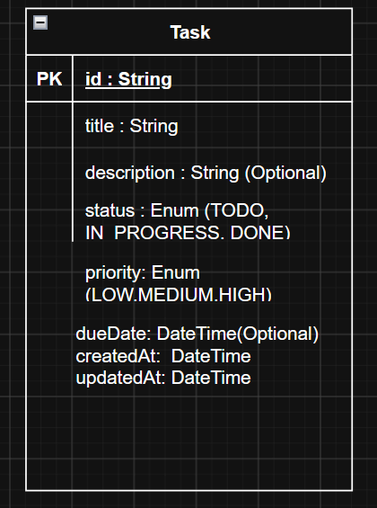

# Архітектурна специфікація: Task Tracker System (spec.md)

## 1. Загальний опис системи та статус реалізації

Система є вебзастосунком для керування завданнями на базі NestJS, SQLite та  Vanilla JS без важких фронтенд-фреймворків.

### 1.1. Поточний стан реалізації

  **Валідація контрактів:** 
  * Маршрутизація контролера зафіксована за шляхом `/api/tasks`.
  * Ідентифікатор завдання `id` типізовано як UUIDv4 із перевіркою через `ParseUUIDPipe` (відхилення некоректних і числових ID зі статусом `400 Bad Request`).
  * Вхідні данні контролюються за допомогою `class-validator` у `CreateTaskDto` та `UpdateTaskDto` (заборона порожніх значень, перевірка строкових типів і допустимих переліків `enum`).
 **Шар збереження даних (Етап 2 — Підготовлено схему):** 
  * Реляційна модель описана в `prisma/schema.prisma` із підтримкою нативних переліків та дедлайнів.
  * Сервіс `TasksService` на даній момент працює в режимі заглушки для верифікації без виконання фінальних транзакцій у файлі `dev.db`.
 **Клієнтський інтерфейс** 
  * Директорію `public/` створено під статичний вебінтерфейс Vanilla JS (`index.html`, `style.css`, `app.js`), роздача якого здійснюватиметься сервером NestJS,на даній момент працює в режимі заглушки.
  

## 2. Розбиття на компоненти/модулі та взаємодія

### 2.1. Опис компонентів та модулів
1. **Frontend (public/):**
   * `index.html`: розмітка форми створення завдань, фільтрів та контейнера списку задач.
   * `style.css`: базові стилі, кольорові бейджі пріоритетів та адаптивна верстка.
   * `app.js`: асинхронні виклики через браузерний `fetch()` до `/api/tasks` та динамічне оновлення DOM.

2. **Backend (src/):**
   * `AppModule`: кореневий модуль; реєструє `PrismaModule` та `TasksModule`.
   * `TasksModule`:
     * `TasksController`: реєструє маршрути `/api/tasks`, зв'язує маршрути з `ParseUUIDPipe` та ініціює валідацію вхідних даних.
     * `CreateTaskDto` / `UpdateTaskDto`: правила `class-validator` для захисту від неправильних значень.
     * `TasksService`: сервісний шар, що на даному етапі працює в режимі заглушки.
   * `PrismaModule` та `PrismaService`: зареєстрований шар доступу до бази даних SQLite (`dev.db`) через Prisma ORM.

### 2.2. Опис взаємодії компонентів
1. **Клієнтський виклик:** Клієнт надсилає HTTP-запит до `/api/tasks`.
2. **Бар'єр валідації:** `TasksController` пропускає запит через глобальний або локальний `ValidationPipe`. Якщо обов'язкові поля відсутні або мають неправильні значення (наприклад, невідомий пріоритет), запит негайно блокується з кодом `400`.
3. **Обробка ідентифікаторів:** Для точкових маршрутів (`/api/tasks/:id`) `ParseUUIDPipe` перевіряє валідність формату UUID. Запити з некоректними типами (як-от приведення `+id` до числа) відхиляються з помилкою `400`.
4. **Сервісна обробка:** Валідований DTO потрапляє у `TasksService`, який повертає відповідь відповідно до вимог.

## 3. Дані та зв'язки (ER-модель)

### Допустимі значення атрибутів (Enums):
* **TaskStatus:**
  * `TODO` завдання очікує виконання (значення за замовчуванням)
  * `IN_PROGRESS` завдання взято в роботу
  * `DONE` завдання виконано
* **TaskPriority:**
  * `LOW` низький пріоритет
  * `MEDIUM` середній пріоритет (значення за замовчуванням)
  * `HIGH` високий пріоритет

## 4. Оновлення даних за ключовими сценаріями
### Сценарій 1: Створення нового завдання
1. **Користувач:** заповнює поля форми (назва, опис, пріоритет) і натискає Додати.
2. **TasksController і ValidationPipe:** валідує `CreateTaskDto`. Якщо поле `title` порожнє або пріоритет не відповідає дозволеним значенням, повертається `400 Bad Request`.
3. **TasksService і PrismaService(Заглушка):** сервіс встановлює початковий статус `TODO` та викликає `prisma.task.create()`.
4. **Користувач:** отримує статус `201 Created`

### Сценарій 2: Зміна статусу завдання
1. **Користувач:** надсилає запит PATCH /api/tasks/:id із новим значенням статусу
2. **TasksService та ParseUUIDPipe:** знаходять запис у базі; якщо його немає - повертає `404`.
3. **Користувач:** отримує `200 OK`

### Сценарій 3: Отримання списку завдань
1. **Користувач:** виконує виклик GET /api/tasks 
2. **TasksController:** приймає запит без додаткової фільтрації параметрів і 
відправляє обробку сервісу.
3. **TasksService (Заглушка):** викликає метод findAll(), повертаючи відповідь. 
4. **Користувач:** отримує статус 200 OK.

### Сценарій 4: Видалення завдання
1. **Користувач:** натискає кнопку видалення
2. **ParseUUIDPipe:** перевіряє валідність формату ідентифікатора :id (при невалідному рядку повертає 400 Bad Request).
3. **TasksService(Заглушка):** викликає метод remove(id), повертаючи рядок This action removes a #${id} task
4. **Користувач:** отримує статус 200 OK.

